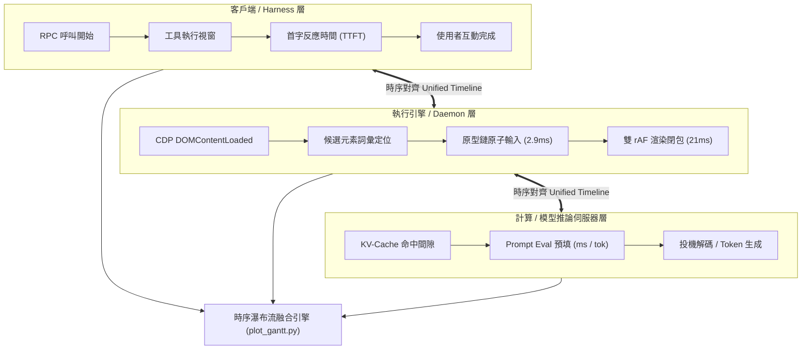

# Universal Time Breakdown Analysis & Bottleneck Optimization Methodology

> **核心第一性原理 (Core First-Principles Directive)**：
> **「總耗時會說謊 (Aggregate Time is a Lie)。」**
> 在任何多階段非同步系統（如 Multi-Agent、LLM 推論、瀏覽器自動化、RAG 管線或分散式微服務）中，嚴格**禁止**使用單一端對端時間（如 `total_seconds: 14.15s`）作為獨立效能評估依據。單一總耗時掩蓋了完全正交的子系統，可能導致假性優化或遮蔽真正的架構瓶頸。
>
> 任何嚴謹的工程效能診斷，**必須**建立在：
> 1. **微觀分軌與毫秒級時序對齊 (Micro-Lane Alignment)**
> 2. **單一變數漸進式版本里程碑 (A/B/C/D Controlled Comparison)**
> 3. **與 AI 協同的蘇格拉底式瓶頸發想協定 (Socratic Bottleneck Brainstorming)**
> 4. **零偏差跨範式功能全驗證 (10/10 Edge-Case Parity Matrix)**

---

## ⚠️ 強制規則：提到 time break down 就一定要畫圖

只要使用者的訊息提到 time break down／time breakdown／時間拆解／耗時拆解／每一步多久，回覆就**必須**包含一張用 `scripts/plot_gantt.py` 畫出的甘特圖 PNG。只給文字表格算沒做完。

1. **先有真實時間戳**：每個步驟都要有 start 和 end（相對於任務開始的秒數）。資料只有開始時間時，先補上結束時間的記錄並重跑一次，不要用猜的。兩個工具呼叫之間的空檔要畫成獨立一條（例如「模型思考」），不能並進工具時間。
2. **寫成 JSONL**，一行一個步驟：
   ```json
   {"phase": "3. click #13", "category": "submit", "rel_start": 9.05, "duration_sec": 1.83}
   ```
   `category` 決定顏色，用這些關鍵字：`open` 藍、`ground` 紫、`plan` 橘（模型思考／推論）、`fill` 綠、`settle` 紅（等待／sleep）、`submit` 青、`render` 金、`io` 深灰，其他是灰。`phase` 可以寫中文（腳本會自動選 Noto CJK 字型）。
3. **畫圖**（輸出放 scratchpad 或該專案的 state 目錄）：
   ```bash
   python3 ~/.hermes/skills/time-break-down-analysis/scripts/plot_gantt.py \
     --jsonl <trace.jsonl> --out <abs/path/gantt.png> --title "<任務> time breakdown (<總秒數>s)"
   ```
   一輪裡有好幾段（例如 LLM 一個 request 的影像編碼 → prefill → decode → 工具）時，每段 JSON 加上同一個 `"lane": "<輪次說明>"`，腳本就會把它們畫在同一列，可再加 `--legend '{"plan":"prefill",...}'` 標示顏色。LLM 的時間要拆到 server 端：llama-server 的 journal 有每個 request 的 `image processed in`、`prompt eval time`、`eval time`，不要把「模型思考」當成一整塊。
   比較多個版本時改用 `--versions <versions.json>`，格式是 `[{"name": "V1 (14.2s)", "spans": [{"phase", "start", "dur", "cat"}]}]`。
4. **自己打開 PNG 看一遍**再交付，確認文字沒有變成方框、長條沒有疊在一起、步驟沒有漏掉。
5. **交付**：先寫一句結論（最大的時間花在哪裡、占幾 %），附上依類別加總的小表，再附圖。在 Piweb／Discord 這類介面要用 `[[file: /absolute/path/gantt.png]]` 的格式附檔。

---

## 🧭 一、 核心工程哲學 (The Engineering Philosophy)

```
┌───────────────────────────────────────────────────────────────────────────────────────┐
│ 1. 總耗時是偽指標 (Single Duration Conflation)                                         │
│    14 秒的任務可能包含：1.5s 網路卡頓 + 2.6s 模型囉嗦 + 0.9s 向量無效推論 + 1.4s 逐字模擬鍵盤 │
│    若只看總秒數，當某層縮減 2 秒時，只要模型稍微多說 100 個 token，優化成果就會被完全掩蓋。   │
├───────────────────────────────────────────────────────────────────────────────────────┤
│ 2. 懷疑每一個非零數值 (Question Every Millisecond)                                     │
│    「為什麼純文字填入要 1.4 秒？鍵盤輸入真的是必要的嗎？」                                │
│    「為什麼網頁沉澱要等 800ms？DOM 早就變了，我們在等什麼？」                             │
│    「為什麼開網頁要等 2 秒？真的是網頁沒載入，還是第三方追蹤碼卡住了事件？」               │
├───────────────────────────────────────────────────────────────────────────────────────┤
│ 3. 拋棄啟發式睡眠 (Banish Heuristic Sleep)                                            │
│    任何寫死在程式碼裡的 `sleep(0.3)`、`sleep(0.6)` 都是架構未成熟的妥協標記。             │
│    必須用事件驅動機制（如雙 `requestAnimationFrame`、`DOMContentLoaded`、DOM 監聽）替代。  │
├───────────────────────────────────────────────────────────────────────────────────────┤
│ 4. 效能優化絕不妥協相容性 (Performance Without Regression)                            │
│    極致的速度如果是建立在破壞 React 18 狀態受控、Vue 3 響應式、或 HTML5 數字校驗上，   │
│    那就只是「製造 Bug 換取的假性速度」。優化必須伴隨跨框架 10/10 嚴格全覆蓋驗證。           │
└───────────────────────────────────────────────────────────────────────────────────────┘
```

---

## 🔬 二、 分析方法論與遙測架構 (Telemetry & Analysis Framework)

### 1. 異質遙測事件匯流 (Heterogeneous Stream Fusion)

將不同層級的獨立日誌，以絕對系統時間戳（Monotonic `perf_counter` 與 ISO-8601）無縫縫合：



### 2. 五大瓶頸分類體系 (Bottleneck Taxonomy)

當分析多階段管線時，任何耗時都可以歸類為以下五類之一：

1. **外部 I/O 阻塞 (External I/O Bound)**：
   - 特徵：等待遠端伺服器回應、第三方追蹤碼、廣告分析像素。
   - 處方：切換為關鍵事件驅動（如從 Window `load` 切換為 `DOMContentLoaded`），隔離非關鍵外部資源。
2. **本機計算過載 (Compute Overload)**：
   - 特徵：CPU/GPU 密集計算佔用長達數百毫秒（例如重型 BERT/E5 dense embeddings、複雜正則迴圈）。
   - 處方：換用輕量演算法（如 BM25 詞彙對齊 + DOM 語意標籤權重），將耗時從 986ms 降至 1ms。
3. **推論 Token 膨脹 (Inference Token Inflation)**：
   - 特徵：模型生成冗長格式（如完整 JSON Schema、多餘思考解釋），生成時間與 Token 數呈線性正比。
   - 處方：設計高密度緊湊微方言（Compact Shortcode Dialect），限制最大生成長度（如 32 tokens）。
4. **事件迴圈串行輪詢 (Event-Loop Serialization Churn)**：
   - 特徵：過度模擬底層細微事件（如 21 個字元分發 63 次 keydown/input/keyup）。
   - 處方：使用原生原型鏈原子賦值（`HTMLInputElement.prototype.value.set`）單步注入，執行時間從 140ms 壓至 2.9ms。
5. **虛擬穩定陷阱與常數輪詢 (False Stability Resets & Fixed Sleep)**：
   - 特徵：旋轉橫幅、動態跑馬燈不斷重置雜湊值，導致靜止計時器無限重置直到超時（如 600ms quiet window 拖滿 2 秒）。
   - 處方：純文字填入走 0ms 沉澱快路徑；提交操作透過雙 `requestAnimationFrame` 保證佈局後立即返回。

---

## 🤝 三、 人機協作：與 AI 共同發想與突破瓶頸的協作協定

今天在 `pi-nodriver-browser` 上能一口氣將 PChome 搜尋從 14.15 秒壓進 5.12 秒（快路徑 3.95 秒），得益於使用者與 Agent 之間建立的這套高效對話協作協定：

```
┌────────────────────────────────────────────────────────────────────────────────────────┐
│ 協作 6 步法 (The 6-Step Collaborative Optimization Protocol)                            │
├─────────┬───────────────────────────┬──────────────────────────────────────────────────┤
│ 步驟    │ 核心行動                  │ 具體協作範例                                     │
├─────────┼───────────────────────────┼──────────────────────────────────────────────────┤
│ Phase 1 │ 攤開黑箱數據              │ 使用者：「給我 pchome 的網頁，我要看 time break   │
│         │ (Transparent Exposure)    │ down。」Agent 繪製出多軌甘特圖，每一毫秒無所遁形。│
├─────────┼───────────────────────────┼──────────────────────────────────────────────────┤
│ Phase 2 │ 蘇格拉底式追問            │ 使用者：「Open 那邊可不可以也套用？那個也跑好久」 │
│         │ (Socratic Probing)        │ 「查一下網路上的人如何做到 20ms 以下？」          │
├─────────┼───────────────────────────┼──────────────────────────────────────────────────┤
│ Phase 3 │ 底層第一性原理重構        │ Agent 與使用者梳理：不是等待 load，而是抓        │
│         │ (First-Principles Design) │ DOMContentLoaded；不是模擬逐字打字，而是 prototype│
│         │                           │ setter；不是神經嵌入，而是 BM25 標籤權重。       │
├─────────┼───────────────────────────┼──────────────────────────────────────────────────┤
│ Phase 4 │ 漸進式測量與甘特圖疊加    │ 使用者：「X axis time, y axis actions, compare   │
│         │ (Incremental Gantt)       │ 三個版本的圖。」嚴格驗證 V1 ➔ V2 ➔ V3 ➔ V4。      │
├─────────┼───────────────────────────┼──────────────────────────────────────────────────┤
│ Phase 5 │ 跨範式 10/10 零偏差驗證   │ 使用者：「表現有偏差嗎？拿十個不同的案例測試看   │
│         │ (10/10 Parity Matrix)     │ 看。」覆蓋 React 18、Vue 3、HTML5、各大實體網站。 │
├─────────┼───────────────────────────┼──────────────────────────────────────────────────┤
│ Phase 6 │ 固化文件並推至生產線      │ 使用者：「commit push update design doc to       │
│         │ (Production Upstream)     │ replace original architecture。」全面更新系統文檔。│
└─────────┴───────────────────────────┴──────────────────────────────────────────────────┘
```

---

## 📊 四、 實戰典範：PChome 24h 自主搜尋 4 階段演化史

### 1. 4-Stage 演化成果與多版本甘特對照

```
┌─────────────────────────────────────────────────────────────────────────────────────────┐
│ PChome 24h 自主搜尋任務：架構演進與延遲對照                                              │
├─────────┬─────────────────────────────────────────────────────────┬────────────┬────────┤
│ 版本    │ 架構設定                                                 │ 總耗時     │ 總改善 │
├─────────┼─────────────────────────────────────────────────────────┼────────────┼────────┤
│ V1 原版 │ 傳統 JSON Planner (120t) + E5 Dense (986ms) + 逐字打字   │ **14.15s** │ 基線   │
│ V2 短碼 │ Compact Shortcode Dialect (32t) + 呼叫端候選去歧義       │ **11.16s** │ -2.99s │
│ V3 詞彙 │ 1ms BM25 LexicalRanker + 搜尋框語意標籤保留 (+50)        │ **8.86s**  │ -5.29s │
│ V4 全套 │ 原型鏈原子注入 (2.9ms) + 雙 rAF 0ms 沉澱 + 微縮遮罩清理 │ **5.12s**  │ **-9.03s**│
│ V4-Fast │ 原子 fill-submit 單步流送                                │ **3.95s**  │**-10.20s**│
└─────────┴─────────────────────────────────────────────────────────┴────────────┴────────┘
```

### 2. 步驟級時間解構表 (Per-Step Time Breakdown)

```
┌─────────────────────────────────────────────────────────────────────────────────────────┐
│ 各階段動作延遲細部拆解 (秒數)                                                           │
├──────────────────────────────┬──────────────┬──────────────┬──────────────┬─────────────┤
│ 執行階段                     │ V1 Legacy    │ V2 Compact   │ V3 Lexical   │ V4 Applied  │
├──────────────────────────────┼──────────────┼──────────────┼──────────────┼─────────────┤
│ Step 1: Open 網頁導航        │ 1.58s        │ 1.58s        │ 1.58s        │ 0.29s (5.4x)│
│ Step 1: 候選元素定位         │ 0.98s        │ 0.98s        │ 0.001s       │ 0.001s(821x)│
│ Step 1: 規劃器推論           │ 2.62s        │ 0.81s        │ 0.78s        │ 0.78s (3.4x)│
│ Step 2: 文字輸入 (Fill)      │ 1.46s        │ 1.46s        │ 1.46s        │ 0.03s(48.7x)│
│ Step 2: 畫面沉澱 (Settle)    │ 0.80s        │ 0.80s        │ 0.80s        │ 0.02s(40.0x)│
│ Step 3: 規劃器推論           │ 2.58s        │ 0.84s        │ 0.81s        │ 0.81s (3.2x)│
│ Step 3: 送出跳轉 (Submit)    │ 1.02s        │ 1.02s        │ 1.02s        │ 0.88s (1.2x)│
│ Step 4: 最終結算沉澱         │ 1.12s        │ 1.12s        │ 1.12s        │ 0.82s (1.4x)│
├──────────────────────────────┼──────────────┼──────────────┼──────────────┼─────────────┤
│ 任務總計時間                 │ 14.15s       │ 11.16s       │ 8.86s        │ **5.12s**   │
└──────────────────────────────┴──────────────┴──────────────┴──────────────┴─────────────┘
```

---

## 🌐 五、 跨領域擴充指南 (Generalization Beyond Browser Automation)

這套方法論不僅適用於瀏覽器自動化，亦可無縫推廣至其他應用：

### 應用情境 A：大型模型 RAG / Research 管線

```
┌──────────────┐     ┌──────────────┐     ┌──────────────┐     ┌──────────────┐
│  Search API  │ ──> │ Crawl 32-Tab │ ──> │ Chunk & Rank │ ──> │ Prefill GPU  │ ──> Answer
└──────────────┘     └──────────────┘     └──────────────┘     └──────────────┘
```
- **拆解維度**：搜尋 roundtrip、背景平行抓取時間窗、BM25 證據分塊、GPU 投機預填等待（Tool Settlement Wait）、首字生成延遲（TTFT）。
- **瓶頸最佳化**：以 Active Prefill 取代 Passive Prefill，在爬蟲傳回第一個 chunk 時即刻併行送入 GPU KV-cache，消滅工具完成後的結算等待。

### 應用情境 B：端側 / 本機 LLM 推論管線

- **拆解維度**：Tokenization 耗時、多模態視覺編碼耗時、Prefix Cache 命中比對、Prompt Evaluation、Thinking Token 耗時、文字解碼輸出率。
- **瓶頸最佳化**：縮減 Thinking Budget（例如從 4096t 縮至 minimal 128t 省下 2 秒）；對常用 System Prompt 進行磁碟 KV-cache 固化。

### 應用情境 C：後端高效能 API 閘道

- **拆解維度**：TLS 握手、中介軟體驗證、非同步資料庫查詢、JSON 序列化、網路出口排程。
- **瓶頸最佳化**：以 Protobuf/FlatBuffers 取代大型 JSON 序列化；以連接池預熱取代每次握手。

---

## 🛠️ 六、 工具鏈與腳本速查 (Tooling Reference)

本 Skill 在 `scripts/` 目錄下隨附了全套即用型工具：

### 1. 快速程式碼插樁器 (`trace_recorder.py`)

無外部相依性，支援 Context Manager 與里程碑標記：

```python
from scripts.trace_recorder import TraceRecorder

recorder = TraceRecorder("my_pipeline_run")

with recorder.span("1. 導航載入", category="open"):
    # 執行操作
    pass

with recorder.span("2. 元素定位", category="ground"):
    pass

recorder.mark("到達第一里程碑")
recorder.print_summary()
recorder.export_jsonl("/tmp/trace.jsonl")
```

### 2. 多版本甘特圖視覺化器 (`plot_gantt.py`)

支援單一執行或多版本堆疊對照圖（自動渲染高解析度 PNG）：

```bash
# 單一執行甘特圖
python3 ~/.hermes/skills/time-break-down-analysis/scripts/plot_gantt.py \
  --jsonl /tmp/trace.jsonl \
  --out /tmp/gantt.png \
  --title "Pipeline Execution Breakdown"
```

或在 Python 腳本中直接呼叫多版本對照：

```python
from scripts.plot_gantt import plot_multiversion_comparison

versions = [
    {"name": "V1: Baseline (14.15s)", "spans": [{"phase": "Open", "start": 0.0, "dur": 1.58, "cat": "open"}, ...]},
    {"name": "V4: All-Applied (5.12s)", "spans": [{"phase": "Open", "start": 0.0, "dur": 0.29, "cat": "open"}, ...]},
]
plot_multiversion_comparison(versions, "Evolution Benchmark", "/tmp/comparison.png")
```

---

## 🎯 總結檢查清單 (The Evaluator's Checklist)

在宣告任何效能優化完成之前，確認以下事項：
- [ ] 是否已將整體時間完整拆解成無重疊或明確平行的微觀子步驟？
- [ ] 是否繪製出 X 軸為時間、Y 軸為動作的多軌甘特圖？
- [ ] 是否逐一懷疑並消除了所有硬編碼的 `sleep` 與無效輪詢？
- [ ] 是否採用單一變數（V1 $\to$ V2 $\to$ V3 $\to$ V4）記錄各優化點的具體貢獻？
- [ ] 是否已完成 10/10 跨範式、跨框架邊界案例的相容性全驗證？
- [ ] 是否已將新架構與驗證圖表回填至專案技術設計文件中？
